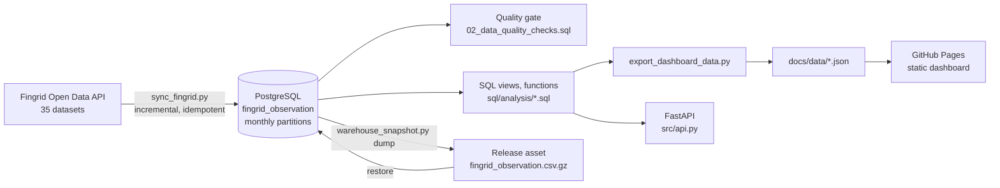

# Grid in SQL: Finland's electricity grid in a PostgreSQL warehouse

[](https://github.com/miladgk/industrial-energy-sql-pipeline/actions/workflows/ci.yml)


**Live site:** [miladgk.github.io/industrial-energy-sql-pipeline](https://miladgk.github.io/industrial-energy-sql-pipeline/)
· **Data download:** [warehouse snapshot](https://github.com/miladgk/industrial-energy-sql-pipeline/releases/tag/warehouse-snapshot) (CSV)

Fingrid, Finland's electricity transmission system operator, publishes hundreds of
measurements and forecasts as [open data](https://data.fingrid.fi), one chart at a
time. This project keeps 35 of them in a partitioned PostgreSQL warehouse, refreshed
every day, and answers questions no single chart does:

| Question | Answer over the last 12 months | Where |
|---|---|---|
| How far off are Fingrid's own forecasts? | Day-ahead wind misses by 442 MW on average (4.7% of the fleet) and runs 171 MW too high; the intraday update halves the miss. Consumption: 328 MW (3.3%). | `sql/analysis/13-17` |
| When will electricity be cleanest tomorrow? | A day-ahead CO2-intensity forecast in SQL. Replayed over 338 days: 4.5 g/kWh mean error vs 7.1 for a naive baseline; the hour it picks emitted 14.8% less than an average hour (19.7% for a perfect pick). | `sql/schema/14`, `sql/analysis/18-19` |
| What unusual happened on the grid? | 802 frequency excursions, 6 fast nuclear drops, 14 low-inertia periods, 12 imbalance-price spikes. The minute before a full hour is out of band 2.1x as often as an average minute. | `sql/schema/15`, `sql/analysis/20-21` |
| How much does cold raise demand? | Below about 15 °C each degree colder adds 154 MW on a weekday (1.5% of average use; r² 0.89). The coldest day (-25 °C) used 14.8 GW, 1.8x the warmest. | `sql/analysis/22-23` |
| Where does an extra MW of wind go? | About 54% replaces imports (74% in summer), 11% replaces hydro, 15% other production (25% in winter, when CHP runs) and 20% is matched by higher consumption. The measured border flows say where it leaves: 32 points over northern Sweden (53 in summer), 16 over central Sweden, 5 over Estonia; district-heating CHP gives way the most (11 points, 20 in winter). Extra nuclear brings the same +20% consumption, which points to demand following cheap power rather than to wind chill. | `sql/analysis/24`, `src/wind_allocation.py` |
| How wrong will tomorrow's forecast be? | Calibrated 80% / 95% ranges around Fingrid's day-ahead wind and consumption forecasts (conformal prediction, grouped by time of day and forecast level, adapting day by day). Replayed over 341 days with only what was known at issue time: wind 79.5% / 93.5% of hours inside, consumption 79.1% / 93.6%; interval score 4-8% better than one set of quantiles. | `sql/analysis/25`, `src/forecast_ranges.py` |
| Can public weather data beat Fingrid's forecast? | No. Gradient-boosted trees on Open-Meteo forecasts made two days ahead (15 places) and the Finnish calendar, replayed over 182 days: wind error 534 MW vs Fingrid's 346, consumption 368 vs 290. Used as a correction to Fingrid's forecast it changes the error by under 1% (Diebold-Mariano p = 0.85 and 0.75). For wind, fresher weather closes 93% of the gap; for consumption it closes none. | `sql/analysis/26`, `src/weather_model.py` |
| Does hydro make more room for wind when its reservoirs are full? | The opposite. Over three years, with five reservoir and lake levels against their 2000-2022 norm for the date (SYKE): on the driest tenth of days hydro absorbs 16% of each extra MW of wind (15-17%), on the fullest tenth 9% (8-11%). Full reservoirs must release water; low ones save it. Imports take about 55% whatever the water. | `sql/analysis/27`, `src/hydro_flex.py` |
| How much electricity did the 2024 strikes take away? | The four-week ports and transport strike (11 Mar - 7 Apr 2024, paper and pulp mills shut) cut consumption by 1,148 MW on average, 11% or 769 GWh, against a counterfactual of weather and calendar; no strike-free placebo period comes close. The two short February strikes show drops too (-922 and -598 MW) but are within the model's ordinary error (p = 0.05 and 0.10). Monthly industrial output (Statistics Finland) does not explain monthly consumption beyond a shared trend. | `sql/analysis/28`, `src/strike_effect.py` |

Numbers as of November 2026; the site always shows the current ones.

Everything is real data. Where the data does not support a claim, the site says so:
solar forecasts are not scored because Fingrid publishes no measured solar output;
the CO2 forecast is a guide to *which* hours are cleaner, not an exact value; and
Finnish nuclear drops and the Nordic-wide frequency rarely confirm each other, so
nuclear trips are not used as labels for the event detector.

---

## Architecture



**Daily refresh** (`.github/workflows/refresh_fingrid.yml`, 10:53 UTC, after Fingrid
publishes the next day's forecasts at 12:00 Finnish time): start PostgreSQL, restore
yesterday's warehouse and weather forecast archive from the release assets, store today's
FMI weather forecasts (src/fmi_forecast.py) and the newest two-day-old Open-Meteo forecasts
(src/openmeteo_forecast.py), update the hydrology archive (src/hydrology.py),
sync the last 7 days from Fingrid,
publish the new snapshot, run the analyses, commit the dashboard JSON and redeploy
Pages. A normal run takes about 2 minutes and some 30 API requests. No server runs between
refreshes.

**Older history** (once, by hand): Actions → *Refresh the Fingrid warehouse* → Run
workflow with `history_from` set (e.g. `2023-11-01`). The sync then also fills every
dataset backwards from its oldest stored slot, one committed window at a time, so a run
cut short is resumed by running it again; it stops where a dataset begins. Three years
of all 35 datasets took 47 minutes locally. Old Fingrid history comes in other shapes
than today's: 3-minute data published as instant readings until spring 2024 (stored as
slots), and periods with two overlapping series of one dataset (the one on the
dataset's own grid is kept; see `src/sync_fingrid.py`).

**Hourly** (`pages.yml`): the newest wind and consumption values are fetched and
deployed with the page, without a commit.

**CI** (`ci.yml`, every pull request): restores the same public snapshot, so every
test runs against real data and needs no Fingrid key.

---

## The warehouse

```
fingrid_dataset (35 rows)                fingrid_observation (~8.9 M rows since Nov 2023, ~3 M more a year)
  dataset_id  PK                           dataset_id  FK -> fingrid_dataset   ┐ primary key
  key, name, unit                          start_time  partition key           ┘
  kind  actual | forecast | capacity |     end_time
        balancing | emission |              value       exactly as published
        system | weather
  resolution                               fetched_at
                                         PARTITION BY RANGE (start_time): one table per month + default
```

- **Raw values only.** One row per dataset and time slot, as Fingrid publishes it: no
  resampling, no gap filling, no clamping. Analyses decide how to treat gaps.
- **Incremental and idempotent** (`src/sync_fingrid.py`): an empty dataset is backfilled
  400 days; otherwise the sync re-reads from the newest stored slot minus 7 days, because
  Fingrid revises recent values. Rows are upserted on the primary key and an unchanged
  value is not rewritten, so a second run changes nothing. Request windows are sized
  from each dataset's resolution so one window fits one API page (1-minute frequency
  goes in 13-day windows).
- **Only ended slots**, except the three day-ahead forecasts (consumption, wind, solar),
  which are published once for the next day and never revised; the CO2 forecast for
  tomorrow needs them (`fingrid_catalog.STORE_FUTURE`).
- **Partitioned by month.** Every query filters one dataset and a time range, so
  PostgreSQL reads only the months it needs. `ensure_fingrid_partitions()` creates
  months on demand (the sync and the restore call it before writing); a default
  partition catches anything else and is checked to stay empty.
- **JIT off** for every session (`src/db_connection.py`): on the partitioned table the
  planner's cost estimate crossed the JIT threshold and compiling cost more than it
  saved, making the analyses 3-6x slower.
- **Snapshot** (`src/warehouse_snapshot.py`): the whole table as one gzip CSV (~9 MB).
  Restoring keeps rows already present, creates only the months it needs, and skips
  datasets the running code does not know, so an older checkout can always read a
  newer snapshot. Only `main` publishes it.

### Benchmark

`scripts/benchmark_warehouse.py` runs the same query (one week of 1-minute frequency,
10,068 of 1,304,158 rows) on three layouts of the real data and writes
[`benchmarks/index_benchmark.md`](benchmarks/index_benchmark.md):

| Layout | Median |
|---|---:|
| Flat table, no index (reads and discards 1.29 M rows) | 52.3 ms |
| Flat table, primary-key index | 2.3 ms |
| Monthly partitions + index (reads one partition) | 2.0 ms |

The index makes the query ~23x faster. Partitioning is about as fast on a single
lookup; it pays off as the table grows (small per-month indexes, old months dropped
whole). `tests/test_performance.py` checks the plans with EXPLAIN in CI.

### The datasets

| Purpose | Fingrid datasets |
|---|---|
| What happened | 74 production, 75 wind, 124 consumption, 188 nuclear, 191 hydro, 398 battery discharge (3-min) |
| Trade | 194 measured net export (3-min; positive = export, so it is negated into net imports); per border 60 northern Sweden, 61 central Sweden, 55 Estonia, 57 Norway (15-min, same sign; they add up to 194) |
| Kinds of plant | 201 district-heating CHP, 202 industrial CHP, 205 reserve and small-scale plants (3-min) |
| Fingrid's forecasts | 165/166 consumption, 245/246 wind, 247/248 solar (day-ahead / every 15 min) |
| Capacity behind them | 267 solar, 268 wind |
| Balancing | 319 imbalance price, 375/376 activated mFRR up/down, 377 mFRR need |
| CO2 and stability | 396 CO2 intensity of consumption, 260 kinetic energy, 422/423 frequency deviation, 177 frequency (1-min) |
| Weather | 178 Helsinki, 182 Jyväskylä, 196 Oulu, 185 Rovaniemi temperature (3-min) |
| Weather forecasts (FMI, CC BY 4.0, no key) | temperature and wind speed for those four cities plus Vaasa, Kokkola, Pori and Raahe, FMI's edited forecast and the Harmonie model, archived every day as issued in `weather_forecast` (FMI keeps no archive of its own) |
| Weather forecasts (Open-Meteo Previous Runs API, CC BY 4.0, no key) | temperature and 100 m wind speed forecast 48 h ahead for the eight places above and seven wind-farm areas, every hour since September 2025; only hours whose 48-hour-old run was certainly out are stored |
| Hydrology (SYKE Hydrology API, CC BY 4.0; NVE, NLOD; no key) | daily water levels of Lokka, Porttipahta, Oulujärvi, Saimaa and Näsijärvi, discharge of the unregulated Tornionjoki and snow water equivalent of three basins since 2000; weekly Norwegian reservoir filling per price area since 1995 (`src/hydrology.py`, table `hydrology_daily`). Discharge below regulated plants is left out on purpose: it is what the plants chose to release |
| Calendar (computed) | Finnish public holidays (Easter by the Meeus algorithm), eves, bridge days, the Christmas period, July, the sun's elevation (`src/finnish_calendar.py`) |

Listed with their purpose in `src/fingrid_catalog.py`.

---

## The analyses

All logic lives in SQL; the API, the reports and the dashboard export run the same files.

| File | What it does | Techniques |
|---|---|---|
| `sql/schema/13_fingrid_warehouse.sql` | tables, partitions, `forecast_vs_actual` view | declarative partitioning, PL/pgSQL, in-place migration |
| `sql/analysis/13_forecast_scorecard.sql` | MAE, bias, RMSE, P95, WAPE per forecast | ordered-set aggregates |
| `sql/analysis/14-16` | error by Finnish hour, by month, the worst days | `AT TIME ZONE`, `ROW_NUMBER()` |
| `sql/analysis/17_forecast_error_vs_balancing.sql` | day-ahead surprise vs mFRR need and activation, imbalance price | binning, `corr()` |
| `sql/schema/14_co2_forecast.sql` | `co2_forecast()`: line of CO2 intensity on residual load, refitted per day on the 60 days ending two days earlier, level-corrected, floored at the training minimum | set-returning SQL function, `regr_slope`, `regr_intercept` |
| `sql/analysis/18-19` | tomorrow's hours and cleanest 3-hour window; the backtest | window frames, `RANK()` |
| `sql/schema/15_grid_events.sql` | `grid_events()`: frequency outside 49.9-50.1 Hz, nuclear drops of 400 MW in 15 min, lowest-1% inertia, price spikes; each nuclear drop cross-checked against frequency | `RANGE` window frames, gaps and islands, `LATERAL` |
| `sql/analysis/21_frequency_by_minute.sql` | out-of-band frequency by minute of the hour | `FILTER` aggregates |
| `sql/analysis/22_temperature_daily.sql` | daily four-city temperature and national consumption | two-level aggregation, `HAVING` |
| `sql/analysis/23_temperature_sensitivity.sql` | hinge model per day type; the balance point (5-20 °C) is searched in SQL, best r² kept | `generate_series` grid, `regr_r2`, `DISTINCT ON` |
| `sql/analysis/24_wind_allocation_panel.sql` + `src/wind_allocation.py` | the hourly power balance (consumption = wind + nuclear + hydro + other + net imports); each part regressed on wind, nuclear and heating degrees with hour, weekday and month fixed effects, Newey-West (HAC) 95% intervals, per season; imports split by border and other production by kind of plant, the parts adding up to their totals | `FILTER` pivot, completeness rules; numpy OLS + HAC |
| `sql/analysis/25_forecast_errors_hourly.sql` + `src/forecast_ranges.py` | Fingrid's day-ahead forecasts next to what happened; split conformal ranges (global, by hour, Mondrian by hour block x forecast level, adaptive conformal inference), each day calibrated on the 90 days ending two days before it and replayed as a backtest (coverage, width, interval score) | `LEFT JOIN` for the future, `VALUES` pairs; numpy |
| `sql/analysis/28_consumption_hourly.sql` + `src/strike_effect.py` | hourly consumption with measured temperature; gradient-boosted counterfactual trained outside the strikes (+/- 3 days); effect = measured - counterfactual; placebo test refitted on 40 strike-free periods of equal length; monthly residual against Statistics Finland's industrial output index, tested on levels, on month-to-month changes and with a trend | `FILTER` pivot, completeness rules; scikit-learn, pandas |
| `sql/analysis/27_hydrology_state.sql` + `src/hydro_flex.py` | each reservoir level and the Tornionjoki's log discharge as a z-score against the 2000-2022 norm for the same date (pooled +/- 7 days); the hourly balance regressed on wind, wind x storage and wind x inflow of the day before, with hour, weekday, month and year fixed effects and Newey-West intervals; shares at the 10th/50th/90th percentile of storage, and a check by thirds of days | window-pooled seasonal norms, `LATERAL`; numpy |
| `sql/analysis/26_weather_model_panel.sql` + `src/weather_model.py` | per hour: actuals, Fingrid's day-ahead forecasts, wind capacity and the two-day-old weather at 15 places; gradient-boosted trees (weather + calendar; and a regularised correction of Fingrid's forecast) in a weekly-refit rolling-origin backtest with Diebold-Mariano tests; Fingrid's error by kind of day. `scripts/weather_lead_time.py` replays it with 24-hour-old and the newest weather | `FILTER` pivot over two tables; scikit-learn, pandas |
| `sql/etl/02_data_quality_checks.sql` | default partition empty, no empty or stale dataset, 30-day coverage, 0 Hz gap markers | |

---

## API

`make api`, then open http://localhost:8000/docs.

Results are cached for `API_CACHE_SECONDS` (default 300 s; the warehouse changes once a day), and concurrent
requests for the same query share one database run. With the warehouse at 2.6 M rows, the load test (20 users,
30 s) had a p95 of 6.6 s without the cache (in CI) and 9 ms with it (run locally).

| Endpoint | Returns |
|---|---|
| `GET /api/datasets` | every dataset with its row count and coverage |
| `GET /api/latest` | the newest stored value of each dataset |
| `GET /api/forecast-scorecard?days=365` | forecast errors (13) |
| `GET /api/forecast-error-by-hour?variable=wind` | the same per Finnish hour (14) |
| `GET /api/co2-forecast?day=YYYY-MM-DD` | hourly CO2 forecast for one day (18); default tomorrow |
| `GET /api/grid-events?days=30&kind=nuclear_drop` | grid events, newest first (20) |
| `GET /api/temperature-sensitivity?days=365` | MW per degree of cold, balance point, r² per day type (23) |

Every parameter is validated (ranges, allow-lists, typed dates); queries run in
read-only transactions; database errors reach the client as a generic 500. The API is
not hosted: the site reads static JSON built from the same SQL, so it never waits for
a server.

---

## Tests

196 tests in eight layers, all run in CI on Python 3.11/3.12 and PostgreSQL 14/15/16,
against the restored real warehouse:

| Layer | What it guards |
|---|---|
| smoke | database, warehouse, API routes and dashboard files are alive |
| api | response shapes, validation, every number equals its SQL file |
| integration | sync, idempotency, revisions, snapshot round trip, partition layout, quality gate |
| regression | hand-made datasets with exact answers through the scorecard, CO2 model, event detector, wind-allocation model (incl. Newey-West vs OLS), Finnish holidays and the weather model (no look-ahead, Diebold-Mariano) |
| performance | EXPLAIN shows pruning and index use; generous latency budgets |
| security | injection payloads rejected, no error leakage, read-only sessions, no secrets in git |
| data | published JSON is internally consistent and matches the SQL in the repo |
| e2e | Chromium: numbers come from the data files, no foreign requests, charts, keyboard, inspector drawer, theme, phone layout, one broken file does not break the page |

Plus a Locust load test, bandit and pip-audit in CI.

---

## Run it yourself

```bash
git clone https://github.com/miladgk/industrial-energy-sql-pipeline.git
cd industrial-energy-sql-pipeline
cp config_template.yaml config.yaml          # database credentials match docker-compose.yml
pip install -r requirements.txt
docker compose up -d                         # PostgreSQL
make db-setup snapshot-restore quality-checks   # the published warehouse, no API key needed
make api                                     # http://localhost:8000/docs
make test                                    # e2e needs: pip install playwright && playwright install chromium
```

To sync new data yourself, add a free key from [data.fingrid.fi](https://data.fingrid.fi)
as `fingrid_api_key` in `config.yaml` (git-ignored) and run `make sync`; an empty
warehouse backfills 400 days in about 15 minutes. `make export` rebuilds the dashboard
files, `make report` writes every analysis to `outputs/*.csv`, `make benchmark`
re-measures the layouts.

For the daily workflow on a fork, add the key as the repository secret
`FINGRID_API_KEY` (Settings -> Secrets and variables -> Actions).

---

## Project structure

```
├── .github/workflows/
│   ├── ci.yml                  # tests, security scan, load test on every PR
│   ├── refresh_fingrid.yml     # daily: restore, sync, snapshot, analyses, redeploy
│   └── pages.yml               # deploy + hourly latest values
├── benchmarks/index_benchmark.md
├── docs/                       # the static dashboard (GitHub Pages)
│   ├── index.html
│   └── data/*.json             # built by scripts/export_dashboard_data.py
├── scripts/
│   ├── export_dashboard_data.py
│   ├── benchmark_warehouse.py
│   ├── weather_lead_time.py    # how much fresher weather would help (run by hand)
│   └── strike_effect.py        # the 2024 strikes event study (run by hand)
├── sql/
│   ├── schema/                 # 13 warehouse, 14 CO2 model, 15 event detector, 16 forecast archive,
│   │                           # 17 hydrology, 18 dataset summary for /api/datasets
│   ├── analysis/               # 13-28, one query per file
│   └── etl/02_data_quality_checks.sql
├── src/
│   ├── fingrid_api.py          # API client (key, paging, retries, 429 back-off)
│   ├── fingrid_catalog.py      # the 35 datasets and why
│   ├── sync_fingrid.py         # incremental, idempotent sync
│   ├── warehouse_snapshot.py   # dump / restore as CSV.gz
│   ├── setup_db.py             # applies sql/schema
│   ├── run_quality_checks.py   # the quality gate
│   ├── run_report.py           # every analysis -> outputs/*.csv
│   ├── analysis_window.py      # default parameters for the analysis SQL
│   ├── wind_allocation.py      # fixed-effects regression with Newey-West intervals
│   ├── forecast_ranges.py      # conformal ranges around Fingrid's forecasts + backtest
│   ├── fmi_forecast.py         # daily FMI weather forecast archive
│   ├── openmeteo_forecast.py   # two-day-old Open-Meteo forecasts, backfilled
│   ├── finnish_calendar.py     # holidays, bridge days, sun elevation
│   ├── weather_model.py        # public weather vs Fingrid: models, backtest, Diebold-Mariano
│   ├── hydrology.py            # SYKE reservoir levels, river flow, snow; NVE reservoirs
│   ├── hydro_flex.py           # does hydro's share of extra wind depend on the water?
│   ├── strike_effect.py        # counterfactual consumption, placebo test, trend-aware monthly check
│   ├── db_connection.py
│   └── api.py                  # FastAPI
└── tests/                      # eight layers + load/locustfile.py
```

---

Data: [Fingrid Open Data](https://data.fingrid.fi), licensed
[CC BY 4.0](https://creativecommons.org/licenses/by/4.0/). Weather data by
[Open-Meteo.com](https://open-meteo.com/) and the [Finnish Meteorological Institute](https://en.ilmatieteenlaitos.fi/open-data),
both CC BY 4.0. Water data by [SYKE](https://www.syke.fi/en) (CC BY 4.0) and
[NVE](https://www.nve.no/) (NLOD). Industrial output by [Statistics Finland](https://stat.fi/en/statistics/ttvi)
(CC BY 4.0). Code: MIT.
